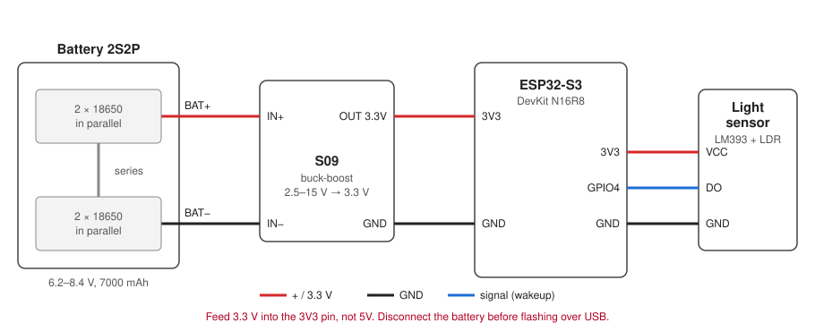

# Smart Boiler Status Monitor 🚿🔥

A battery-powered ESP32-S3 device that watches the boiler's indicator light and sends push notifications to your phones when the boiler turns on, turns off, or stays on too long.

The boiler control panel in my apartment is far from the living area, so it's easy to forget the boiler running and waste electricity. This device sits next to the panel and tells me.

## Features

- **Instant detection:** the ESP32-S3 sleeps in deep sleep and wakes the moment the indicator light changes (ext0 wakeup on the light sensor's digital output).
- **Push notifications via [ntfy](https://ntfy.sh):** free, no account, works on Android and iPhone. Any number of phones can subscribe to the same topic.
- **Reminder** every 30 minutes while the boiler stays on, including how long it has been on.
- **Daily "alive" message:** if it stops arriving, the battery is empty.
- **Low power:** WiFi only turns on to send a message; reduced TX power (11 dBm) to avoid brownouts.
- **Reliable delivery:** state is saved only after a successful send; failed sends are retried every 2 minutes.

## Hardware

| Part | Details |
|---|---|
| Microcontroller | ESP32-S3 DevKit (ESP32-S3-WROOM-1 N16R8) |
| Power | 4 × Vapcell M35 18650 3500 mAh in **2S2P** (7.4 V nominal, 7000 mAh) |
| Regulator | S09 DC-DC buck-boost, 2.5–15 V in → 3.3 V out |
| Light sensor | LDR module with LM393 comparator, 3 pins (VCC, GND, DO) + sensitivity potentiometer |

### Wiring



| From | To |
|---|---|
| Battery pack + / − | S09 IN + / − |
| S09 3.3 V OUT | ESP32 **3V3** pin (not 5V) |
| S09 GND | ESP32 GND |
| Light sensor VCC / GND | 3V3 / GND |
| Light sensor DO | **GPIO4** |

📷 *Photos of the finished build coming soon.*

More details (pin choices, design decisions, power notes): [docs/hardware.md](docs/hardware.md).

## ⚠️ Battery safety

- The cells are most likely **unprotected** and there is **no BMS**.
- The current build has **no battery voltage measurement**. The S09 keeps running down to 2.5 V input (~1.25 V per cell), which permanently damages Li-ion cells.
- Treat the **daily "alive" message** as the battery indicator: if a full day passes without it, remove the cells and charge them.
- **Charging:** take all four cells out, charge them all equally in an 18650 charger, and put them back. Never charge them inside the device, and never mix charged and uncharged cells.
- **Disconnect the battery before flashing over USB**, otherwise two 3.3 V sources run in parallel.

## Setup

1. Install the [Arduino IDE](https://www.arduino.cc/en/software) and the **esp32 by Espressif** board package (core 3.x).
2. Open `boiler_monitor_esp32s3/boiler_monitor_esp32s3.ino`.
3. Copy `secrets.example.h` to `secrets.h` in the same folder and fill in your WiFi name, password, and a long random ntfy topic.
4. Board: **ESP32S3 Dev Module**. Upload.
5. Install the **ntfy** app on each phone and subscribe to your topic.
6. Calibrate the light sensor: turn the potentiometer until the module's DO LED follows the boiler's indicator light.

### Settings

At the top of the sketch:

| Setting | Default | Meaning |
|---|---|---|
| `LIGHT_ON_LEVEL` | `LOW` | DO level when light is detected (flip if your module is opposite) |
| `REMINDER_MIN` | `30` | Reminder interval while the boiler is on |
| `ALIVE_H` | `24` | "Alive" message interval |
| `TX_POWER` | `WIFI_POWER_11dBm` | WiFi transmit power |
| `BATTERY_MONITOR` | `0` | Set to `1` only after adding a voltage divider on GPIO5 |

## Security notes

- **The ntfy topic is the only "password".** Anyone who knows it can read your notifications and send fake ones. Use a long random topic and keep it in `secrets.h`, which is never committed.
- **TLS certificate is not verified.** The sketch connects to ntfy.sh over HTTPS but calls `client.setInsecure()`, so the connection is encrypted but the server's identity isn't checked. That's an accepted trade-off for a home notifier that only sends on/off messages; for stricter security, pin the ntfy.sh root certificate with `client.setCACert()`.

## Repository layout

```
boiler_monitor_esp32s3/   main sketch
tools/power_test_esp32s3/ power stress test: checks the regulator holds 3.3 V during WiFi
docs/                     hardware notes, wiring diagram, pre-release checklist
legacy/nano/              the original Arduino Nano + Bluetooth version
```

## Previous version

The first version used an **Arduino Nano**, an LDR on A0, a 9 V battery, and an HC-05/06 Bluetooth module with the Dabble app. It's kept in [legacy/nano/](legacy/nano/), with its own README and schematic.

It was replaced because the ESP32-S3 has no Bluetooth Classic (so Dabble won't work), and WiFi + ntfy reaches phones anywhere, not just within Bluetooth range.

## License

[MIT](LICENSE)
