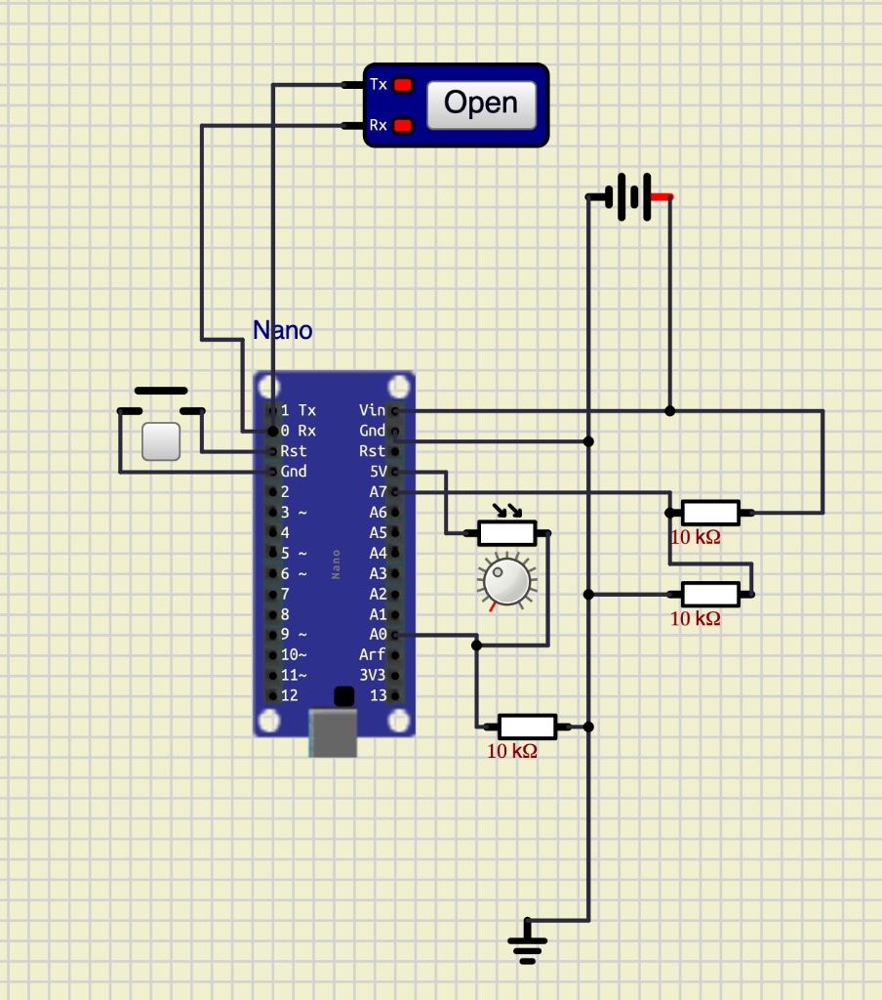

# Legacy version: Arduino Nano + Bluetooth

The first version of the boiler monitor (2025). It's kept here for reference; the current version is the ESP32-S3 sketch in the repo root.

## What it did

- Checked the boiler indicator light every 3 seconds with an LDR module.
- Sent a phone notification through the **Dabble** app over Bluetooth when the boiler turned on or off.
- Sent a one-time alert when the boiler had been on for more than 30 minutes.
- Measured the 9 V battery through a voltage divider and alerted below 7.2 V (alert re-armed above 8.0 V).
- Printed status and battery voltage to Dabble's terminal.

## Hardware

| Part | Connection |
|---|---|
| Arduino Nano | powered from a 9 V battery on Vin |
| LDR module (digital out, LOW = light) | **D2** |
| Battery divider (2 × 10 kΩ, ratio 2) | **A0** |
| HC-05/06 Bluetooth module | D3 / D4 (Dabble serial, 9600 baud) |

> The code is the source of truth for the pins above. The original top-level README listed the LDR on A0 and the battery on A6, which doesn't match `BoilerMonitor.ino`.

## Files

| File | What it is |
|---|---|
| `BoilerMonitor.ino` | The sketch (needs the Dabble library) |
| `schematic.jpeg` | Circuit schematic |
| `LDR circuits.sim1` | Circuit simulation file |

## Why it was replaced

- The Nano never sleeps, so a 9 V battery lasts only days.
- Bluetooth notifications only work while the phone is in range and the Dabble app is connected.
- The ESP32-S3 has no Bluetooth Classic (Dabble can't run on it), so the new version uses WiFi and [ntfy](https://ntfy.sh) instead, which reaches the phones anywhere.
